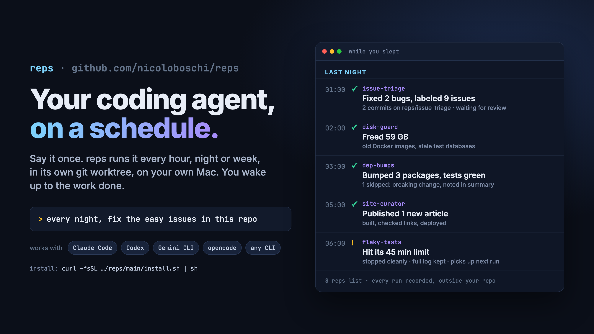
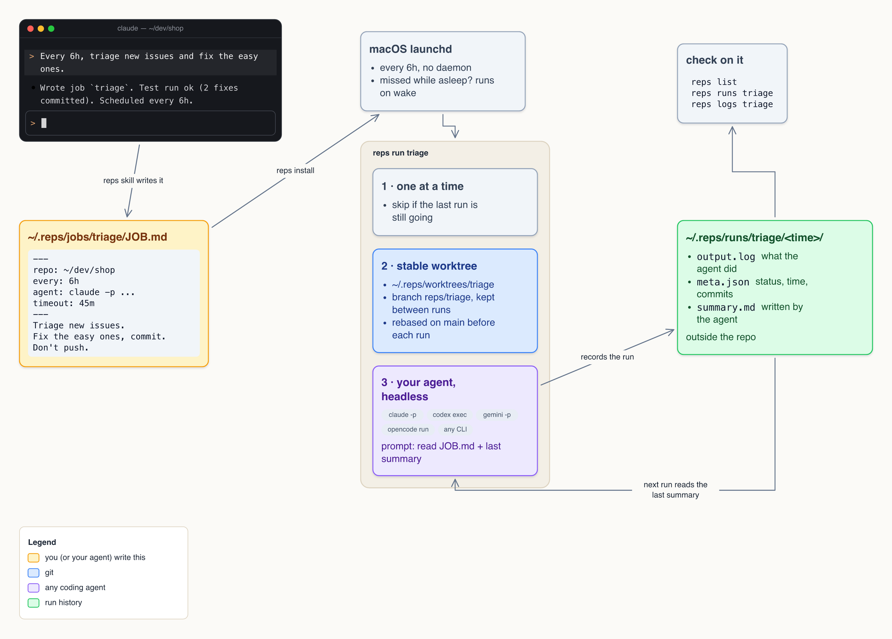

# reps



Tell Claude Code, Codex or any agent *"every 6 hours, triage new issues and fix the easy ones"*.
reps gives that job its own git worktree, runs the agent headless on time, and keeps a record of every run.
No server, no cloud, no daemon. One Python file and macOS's own scheduler.

## Install

```sh
curl -fsSL https://raw.githubusercontent.com/nicoloboschi/reps/main/install.sh | sh
```

This puts `reps` in `~/.local/bin` and installs a skill for every agent it finds
(`~/.claude`, `~/.codex`, `~/.agents`, `~/.gemini`). Then just ask your agent to schedule something.
It writes the job, does a test run, shows you the result, and schedules it.

Run the same line again, or `reps update`, to update. Needs macOS, git and Python 3.9+.

## How it works



- **Any agent.** The job says which command to run: `claude -p`, `codex exec`, `gemini -p`, `opencode run`, or anything else with a headless mode.
- **A stable worktree per job.** `~/.reps/worktrees/<job>` on branch `reps/<job>`, kept between runs and rebased on main before each one. If the last run left uncommitted work or the rebase conflicts, reps leaves it alone and says so. Your own checkout is never touched.
- **Memory between runs.** Each run is pointed at the last run's summary, so the agent picks up where it left off.
- **Runs recorded outside the repo.** `~/.reps/runs/<job>/<time>/` holds the output, a summary the agent writes, and the status.
- **Safe to leave alone.** One run at a time per job, a time limit that kills the agent and everything it started, and runs missed while the Mac slept fire once on wake.
- **Jobs without a repo.** Leave out `repo:` and the agent runs in the job's folder: disk cleanup, reports, checks.

## A job

A job is a folder `~/.reps/jobs/<name>/` with a `JOB.md`. Your agent usually writes it for you.

```markdown
---
repo: ~/dev/shop             # optional
every: 6h                    # 30m, 6h, 1d. Leave out to run only by hand
agent: claude -p --output-format stream-json --verbose --permission-mode acceptEdits --allowedTools=Read,Edit,Bash(git:*)
timeout: 45m                 # default 1h
base: origin/main            # default: origin/HEAD, else the repo's current branch
---
Triage issues opened since your last run. Fix the easy ones, one commit each.
Don't push. List the rest in your summary.
```

The agent gets the prompt as its last argument and no stdin, so it must not wait for approval.
Write list flags with `=` (`--allowedTools=a,b`), or they swallow the prompt.

## Commands

```sh
reps run <job>      # run now (skipped if it is already running)
reps install        # schedule every job with `every:`; removes deleted jobs
reps list           # every job: schedule, runs, ok/failed, last status
reps runs <job>     # every run: status, duration, new commits
reps logs <job>     # last run: status, summary, what the agent did (--run <id> for an older one)
reps update         # update reps and the skill
```

`list`, `runs` and `logs` take `--json` for scripts. `REPS_HOME` (default `~/.reps`) and `REPS_JOBS`
(default `~/.reps/jobs`) move things elsewhere.

## Limits

macOS only for scheduling (on Linux, `reps run` works; call it from cron).
reps never pushes or opens PRs itself; say so in the job if you want it.

Tests: `python3 test_reps.py` runs everything end to end with a fake agent.
